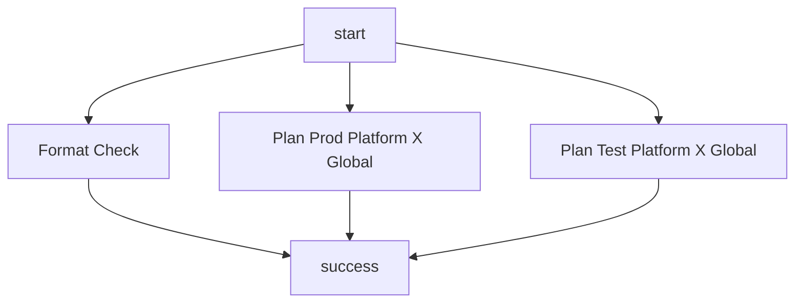
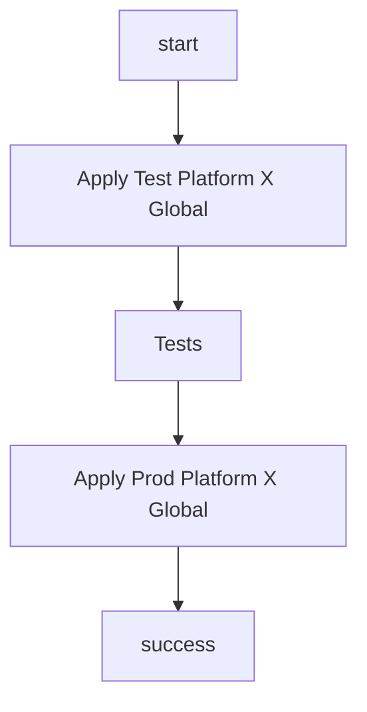

# Deploying a Terraform Workload Without Plan Policy Checks

## Pipelines Running on Unprotected Branches



## Pipelines Running on Protected Branches

### Without Policy Checks



## Example Implementation

```yml
include:
  # Deployment Workflow Components
  - component: ${CI_SERVER_FQDN}/engineering/dev-tools/internal/gitlab-cicd-deployment-workflow/workflow@2
  - component: ${CI_SERVER_FQDN}/engineering/dev-tools/internal/gitlab-cicd-deployment-workflow/deploy-if-protected@2
    inputs:
      environment-deployment-tier: testing
      environment-name: test/platx/global
  - component: ${CI_SERVER_FQDN}/engineering/dev-tools/internal/gitlab-cicd-deployment-workflow/deploy-if-protected@2
    inputs:
      environment-deployment-tier: production
      environment-name: prod/platx/global
  # Terraform Components
  - component: ${CI_SERVER_FQDN}/engineering/dev-tools/internal/gitlab-cicd-terraform/format-check@4
    inputs:
      terraform-image-version: "1.6"
  - component: ${CI_SERVER_FQDN}/engineering/dev-tools/internal/gitlab-cicd-terraform/plan-and-apply@4
    inputs:
      environment: test
      provider: platx
      region: global
      use-plan: false
  - component: ${CI_SERVER_FQDN}/engineering/dev-tools/internal/gitlab-cicd-terraform/plan-and-apply@4
    inputs:
      environment: prod
      provider: platx
      region: global
      use-plan: false

stages:
  - main

default:
  image:
    name: ${CI_DEPENDENCY_PROXY_DIRECT_GROUP_IMAGE_PREFIX}/hashicorp/terraform:1.6
    entrypoint:
      - "/usr/bin/env"
      - "PATH=/usr/local/sbin:/usr/local/bin:/usr/sbin:/usr/bin:/sbin:/bin"

# ---
# Unprotected Pipeline
# ---
# These jobs are run when the pipeline context is unprotected (e.g., unprotected branch pipelines).
#
# They extend:
#
# 1. The workflow component hidden job `.run-if-unprotected` to only run the job in unprotected contexts.
# 2. The the terraform cicd component hidden jobs such as `.format-check` and `.plan:test:platx:global`.
#
# There aren't any dependencies between the jobs, so they all run at the same time.
# ---

terraform-format-check:
  stage: main
  extends:
    - .format-check
    - .run-if-unprotected

plan:test:platx:global:
  stage: main
  extends:
    - .plan:test:platx:global
    - .run-if-unprotected
  before_script:
    # Retrieve temporary credentials authorized to:
    #
    # 1. read test tf state
    # 2. read infrastructure in the test platform x environment
    - echo "retrieving temporary credentials...";

plan:prod:platx:global:
  stage: main
  extends:
    - .plan:prod:platx:global
    - .run-if-unprotected
  before_script:
    # Retrieve temporary credentials authorized to:
    #
    # 1. read prod tf state
    # 2. read infrastructure in the prod platform x environment
    - echo "retrieving temporary credentials...";

# ---
# Protected Pipeline
# ---
# These jobs are run when the pipeline context is protected (e.g., protected branch pipelines).
#
# They extend:
#
# 1. The deployment workflow component hidden job `.run-if-protected` to only run the job in protected contexts.
# 2. The deployment workflow component hidden jobs such as `.deploy-if-protected:testing:test/platx/global` to add deployment context to the jobs.
# 3. The the terraform cicd component hidden jobs such as `.apply:test:platx:global`.
#
# They use the 'needs' keyword to construct the following DAG:
#
# - start --> apply:test:platx:global
# - apply:test:platx:global --> test:test
# - test:test --> apply:prod:platx:global
# - apply:prod:platx:global --> end
# ---

apply:test:platx:global:
  stage: main
  extends:
    - .apply:test:platx:global
    - .deploy-if-protected:testing:test/platx/global
  before_script:
    # Retrieve temporary credentials authorized to:
    #
    # 1. manage test tf state
    # 2. manage infrastructure in the test platform x environment
    - echo "applying changes ..."

test:test:
  stage: main
  extends:
    - .run-if-protected
  needs:
    - apply:test:platx:global
  script:
    # Runs integration tests against the deployment to the test platform x environment
    - echo "running integration tests ..."

apply:prod:platx:global:
  stage: main
  extends:
    - .apply:prod:platx:global
    - .deploy-if-protected:production:prod/platx/global
  needs:
    - test:test
  before_script:
    # Retrieve temporary credentials authorized to:
    #
    # 1. manage prod tf state
    # 2. manage infrastructure in the prod platform x environment
    - echo "applying changes ..."
```

### Credential Management Considerations

**Important note for users:**

This pipeline example **does not include credential retrieval or environment access logic.** Instead, it provides `before_script` placeholders in each plan and apply job for inserting credential retrieval commands.

Users are encouraged to integrate a solution like gitlab-cicd-temp-creds components to automate the retrieval and injection of **temporary access credentials** needed for interacting with Terraform backends and cloud providers.
